# LTree Commander

**A native Linux clone aiming to reproduce ZTreeWin / ZTreeBold as faithfully as possible.**

LTree Commander brings the directory tree, file tagging, Branch/Showall lists and contextual keyboard commands of **ZTreeWin / ZTreeBold by ZEDTEK, Inc.** to Linux. It keeps the classic blue, cyan and yellow interface while adapting paths, permissions, symbolic links, mounted filesystems and shell integration to Linux. **ZTreeWin 2.2.19 is the main behavioral reference.**

**Executable:** `ltc` · **Version:** `0.1.0-alpha.1` · **License:** [GPL-3.0-or-later](LICENSE) · **Interfaces:** graphical and terminal

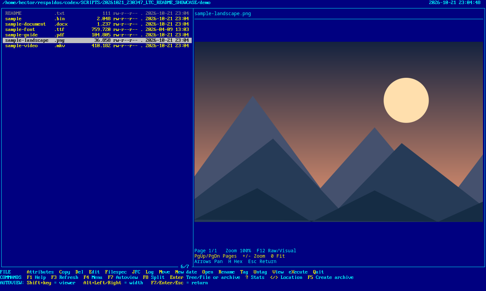

*Graphical F7 Autoview displays the selected image beside the file list. Terminal mode retains text and hexadecimal previews. All screenshots show the actual program with synthetic example files.*

This is a working alpha. Many daily file operations are implemented; full ZTree compatibility remains a development goal. See [current capabilities and limitations](docs/ALPHA.md).

[Features](#features) · [Graphical and terminal modes](#graphical-and-terminal-modes) · [Installation and build](#installation-and-build) · [First steps](#first-steps) · [Screenshots](#screenshots) · [Documentation](#documentation) · [Credits and license](#credits-and-license)

## Features

### Trees, panels and file lists

- Navigate a directory tree, log branches and collect files with **Branch**, **Showall** and **Global** views.
- Work with two independent panels using **F8**; switch between them with **Tab**.
- Tag files, filter with **Filespec**, sort lists and reuse persistent search/path histories.
- See logged branch sizes by default. Use `--no-tree-sizes` to hide them.
- Choose mounted locations with aligned filesystem, free-space and total-space columns.

### File and directory operations

- Copy, move, rename and delete individual files or tagged groups, including supported masks and operations that preserve directory structure.
- Follow transfer progress and refresh affected panels after changes.
- Create directories and symbolic links; manage branches with **Prune** and **Graft**.
- Edit timestamps and permissions. Attribute display adapts to the filesystem: POSIX permissions on Linux filesystems, and DOS **HRSA** flags on supported FAT/exFAT/NTFS mounts.
- Compare files or directories and open a shell in the selected directory with **X**.

### Search, view and edit

- Search file contents as **Text**, **Hex**, **Unicode** or **regular expressions**, with progress and hit counts.
- Carry the search into the **V** viewer and use **Space** to navigate matching content.
- Inspect text and hexadecimal bytes, change viewer modes and edit existing bytes with the internal hex editor.
- Use **E** for editing. Terminal text editing follows the configured system editor, including `~/.selected_editor`, `VISUAL` and `EDITOR`; detected binary files use the internal hexadecimal editor. In terminal mode, **O** follows the same editing behavior.
- Read a navigable, contextual manual with **F1**.

### Compressed files

- Open recognized archives with **Enter**, browse members, search and extract their contents.
- Create **ZIP, TAR, TAR.GZ, TAR.BZ2, TAR.XZ and 7Z** archives, plus single-file **GZ, BZ2 and XZ** streams.
- ZIP support is part of the normal workflow for exchanging files with Windows users.
- Archive operations use **libarchive**. RAR support depends on its available readers and still needs broader testing. Members cannot yet be edited in place.

## Graphical and terminal modes

Both interfaces share the file-operation engines. The terminal interface supports the same portable workflows, with menus and keys adapted to what the terminal can transmit.

| Capability | Graphical interface | Terminal interface |
| --- | --- | --- |
| Trees, panels, tags, search, transfers and archives | Available | Available |
| Text/hex viewer and internal hexadecimal editing | Available | Available |
| F7 visual previews | Images, documents, fonts and video thumbnails | Original text and hexadecimal bytes only |
| Command modifier menus | Alt/Ctrl modifier keys | Supported keyboard protocols, or **F4/F10** menus |
| Text editor | Desktop editor integration | Configured terminal editor |
| Shell with **X** | Embedded shell, with desktop integration where available | Shell in the current terminal |
| Window state | Saved size/state; **Alt+Enter** toggles fullscreen | Controlled by the terminal emulator |
| Instances | One graphical instance by default; `--new-instance` overrides it | Independent terminal sessions |
| Qt dependency | Required | **Completely absent from a terminal-only build** |

**Terminal mode works without X11, Wayland or a graphical desktop, including over SSH.** Kitty is optional. Even in Kitty, file previews remain raw text/hex; LTC does not send graphical preview protocols from terminal mode. See [terminal commands and key limitations](docs/TERMINAL.md).

A combined graphical/terminal executable still depends on the Qt libraries linked into it. To compile and run with **no Qt SDK, runtime, plugins or font converter**, use the [terminal-only recipe](#terminal-only-build-on-debian-12).

### Graphical F7 previews

F7 previews the selected file beside the list. Rendering happens in the background; obsolete selections are discarded. Text/hex remains accessible with **Shift+F12** and **Shift+H**.

| File type | Preview | Requirement |
| --- | --- | --- |
| Images, including PNG/JPEG and other installed formats | Image fitted to the panel, with zoom and pan | Qt image plugins for the selected format |
| PDF | Document pages | Poppler: `pdfinfo` and `pdftoppm` |
| DOCX/DOC/ODT/RTF, XLSX/XLS/ODS, PPTX/PPT/ODP | Document pages converted to a temporary PDF | LibreOffice and Poppler |
| TTF/OTF, collections, WOFF/WOFF2 and supported font formats | Font specimen and Unicode glyph pages | FreeType support for the selected format |
| Uncompressed PF2 | Bitmap font specimen and glyph pages | Native PFF2 reader |
| MKV/MP4/AVI/WebM/MOV and other recognized video extensions | Fixed thumbnail | Valid shared desktop thumbnail, or FFmpeg |

Office conversion uses an isolated temporary LibreOffice profile with macros disabled. Font previews do not install fonts. Original documents and media remain unchanged.

Video previews first check the shared desktop thumbnail cache used by applications such as Nautilus. LTC validates the file URI, modification time and stored size when present. Cached images are labelled **Desktop thumbnail** because their frame timestamp is unknown. A cache miss uses `ffprobe` and `ffmpeg` to read a still frame and metadata. Newly created desktop thumbnails can replace an open fallback preview. Videos do not play automatically, and paging keys do not seek through them.

In graphical Autoview, **Shift+PgUp/PgDn** changes document or font pages. Hold **Shift** while using the viewer keys: **+ / -** for zoom and arrows for pan. The mouse wheel changes pages; **Ctrl+wheel** zooms. Video previews retain zoom and pan while keeping the thumbnail fixed.

Optional helpers on Debian:

```bash
sudo apt install poppler-utils libreoffice ffmpeg
```

These programs are only needed for the corresponding graphical previews. Text/hex viewing and terminal-only builds do not need them.

## Installation and build

The source recipes below build the repository directly. For detailed prerequisites, private Qt SDKs, console-font setup, tests and troubleshooting, see the [build and installation guide](docs/BUILD.md).

### Install a supplied Debian package

If you have a `.deb` built for your Debian version and CPU architecture, install or update it with:

```bash
sudo dpkg -i ./ltree-commander_VERSION_ARCH.deb
```

Replace the filename with the actual package. Use **amd64** for x86-64 machines and **arm64** for a 64-bit Raspberry Pi 5 installation. This command installs an existing package; it does not compile the application. Check the assets and notes of the chosen [GitHub release](https://github.com/dejotaerre/ltree-commander/releases) for published packages.

### Terminal-only build on Debian 12

**No Qt dependency.** Install the compiler, build tools and terminal libraries:

```bash
sudo apt update
sudo apt install build-essential cmake ninja-build git pkg-config \
  libarchive-dev libncurses-dev libicu-dev libpcre2-dev nlohmann-json3-dev \
  bash coreutils diffutils

git clone https://github.com/dejotaerre/ltree-commander.git
cd ltree-commander
cmake -S . -B build-terminal -G Ninja \
  -DCMAKE_BUILD_TYPE=Release -DBUILD_TESTING=OFF -DLTREE_BUILD_GUI=OFF
cmake --build build-terminal -j 4
./build-terminal/ltc
```

This executable uses C++/POSIX, ICU, PCRE2, nlohmann JSON, libarchive and ncursesw. It always selects terminal mode, so `--terminal` is optional. Keep those runtime libraries installed. The [terminal-only build guide](docs/BUILD.md#build-only-the-terminal-interface) includes the Arch/CachyOS dependency list.

### Graphical and terminal build on Arch Linux / CachyOS

The graphical interface requires **Qt 6.11+**, QTermWidget built for Qt 6, FreeType, libpng and OpenSSL Crypto. Python/fontTools and a PSF2 console font are used for its embedded shell font.

```bash
sudo pacman -Syu --needed gcc cmake ninja git qt6-base qtermwidget \
  libarchive freetype2 libpng openssl python-fonttools kbd gzip pkgconf \
  ncurses bash coreutils diffutils

pkg-config --modversion Qt6Core
python3 -c "import fontTools; print(fontTools.__version__)"
test -r /usr/share/kbd/consolefonts/default8x16.psfu.gz

git clone https://github.com/dejotaerre/ltree-commander.git
cd ltree-commander
cmake -S . -B build -G Ninja \
  -DCMAKE_BUILD_TYPE=Release -DBUILD_TESTING=OFF
cmake --build build -j 4
./build/ltc
```

Both interfaces are enabled by default. On other distributions, installing a package named `qt6-base-dev` does not guarantee the required Qt version. See [Debian/Ubuntu graphical prerequisites and private SDKs](docs/BUILD.md#debian--ubuntu-and-other-distributions). Use `-DLTREE_BUILD_TERMINAL=OFF` if you want a graphical-only build.

### Install a compiled executable for your user

From the repository root, choose the executable you built:

For a terminal-only build:

```bash
install -Dm755 build-terminal/ltc "$HOME/.local/bin/ltc"
```

For a combined graphical/terminal build:

```bash
install -Dm755 build/ltc "$HOME/.local/bin/ltc"
```

Run the command for your chosen build. Keep `~/.local/bin` in your shell's `PATH`, and keep the runtime libraries required by your build installed. A graphical build also needs its configured PSF font at runtime. There are no CMake install rules yet.

The [desktop launcher and icon instructions](docs/BUILD.md#desktop-launcher-and-icon) add LTC to the application menu without changing global desktop shortcuts.

### Architectures and tests

Both **x86-64/amd64** and **ARM64**, including Raspberry Pi 5, have been built and tested. Build natively on the target architecture or use a compatible package. An amd64 executable does not run natively on ARM64. For older servers, compile on the oldest distribution you intend to support or use a matching build container.

The quick starts disable tests. Enable them with `-DBUILD_TESTING=ON`, then run:

```bash
ctest --test-dir build --output-on-failure
```

Use `build-terminal` for the terminal-only build. Terminal tests additionally need Python 3, `zip` and `7z`; graphical tests also need Qt Test. Visual-reader tests use their optional helpers when available. See [test prerequisites](docs/BUILD.md#run-the-tests).

## First steps

| Command | Behavior |
| --- | --- |
| `ltc` | Start in the current shell directory |
| `ltc /path/to/folder` | Select an explicit directory |
| `ltc --terminal` | Force terminal mode in a combined build |
| `ltc --no-tree-sizes` | Hide logged branch sizes |
| `ltc --version` | Show the release and source build identifier |

Without a graphical environment, the combined executable selects terminal mode automatically. Starting without a directory shows the current location inside the filesystem tree, with ancestors and neighboring folders available for navigation.

| Context | Keys | Action |
| --- | --- | --- |
| Tree | **\***, **B** | Log a branch; show its collected files |
| Tree / files | **Enter** | Switch between tree and files; open a recognized archive from files |
| Files | **T / U**, **Ctrl+T** | Tag / untag a file; tag the visible files |
| Files | **Ctrl+S** | Search tagged file contents |
| Search prompt | **F4**, **F2** | Choose Text/Hex/Unicode/Regex; toggle case sensitivity |
| Files / viewer | **V**, **Space** | View a file; continue through search matches |
| Tree / files | **F**, **Up** | Enter a Filespec; retrieve its history |
| Files | **C / M / D / R / A / N** | Copy / move / delete / rename / attributes / timestamps |
| Files | **Ctrl+key** | Apply supported commands to tagged files |
| Files | **Alt+C / Alt+M** | Copy / move tagged files with paths |
| Tree | **M / D / Alt+P / Alt+G** | Make directory / delete empty directory / Prune / Graft |
| Tree / files | **L** | Choose a mounted location or enter a path |
| Tree / files | **F7 / F8 / Tab** | Autoview / split panels / switch panel |
| Tree / files | **F4** | Select an alternate command menu |
| Viewer | **F10** | Cycle viewer command menus |
| Tree / files | **X / F1** | Open the shell / contextual manual |
| Graphical interface | **Alt+Enter** | Toggle fullscreen |

The interface and prompts are in **English**. In classic terminals, some modifier combinations produce the same input as other keys; **F4/F10** menus keep the corresponding commands accessible. Desktop shortcuts remain under the desktop's control: archives open with **Enter**, preserving GNOME's Alt+F5 shortcut.

The sidebars and `ltc --version` show the release and a source **build identifier**. The release version changes for releases; the identifier distinguishes code changes between releases.

## Screenshots

Screenshots use synthetic project files, sample documents and generated media. Click an image for its full resolution. The gallery below shows both interfaces and the main file workflows.

### Directory tree, branch sizes and file statistics

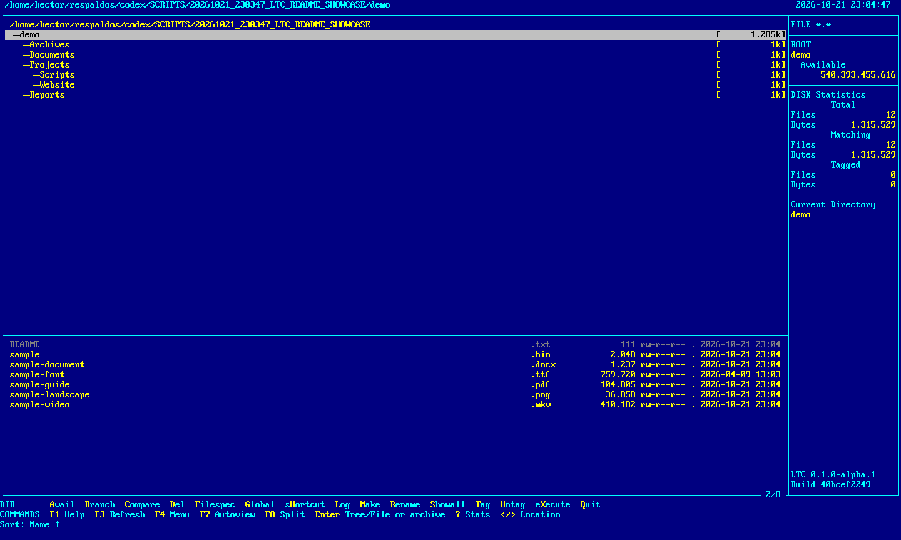

The tree and file list share a panel; logged sizes and statistics remain visible beside it.


### Split panels and Branch file list

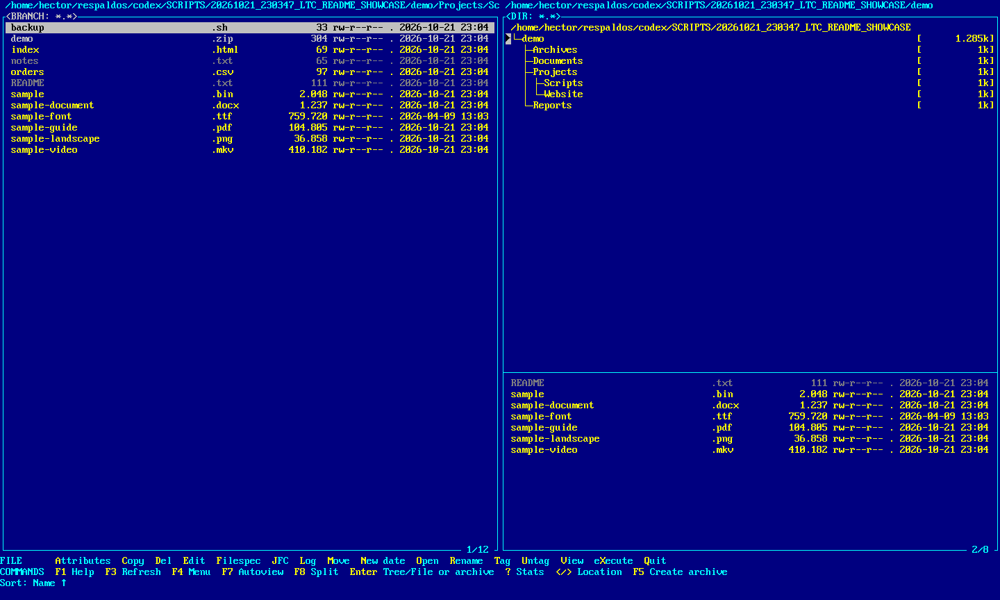

Collect files from a branch on one side while navigating directories and their files on the other. Each panel retains its own location and selection.


### PDF and DOCX document previews

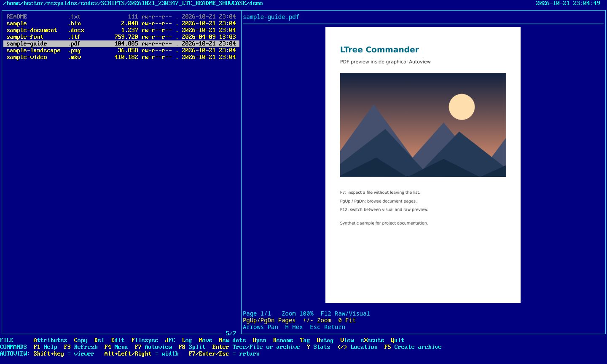

PDF pages are rendered with Poppler.

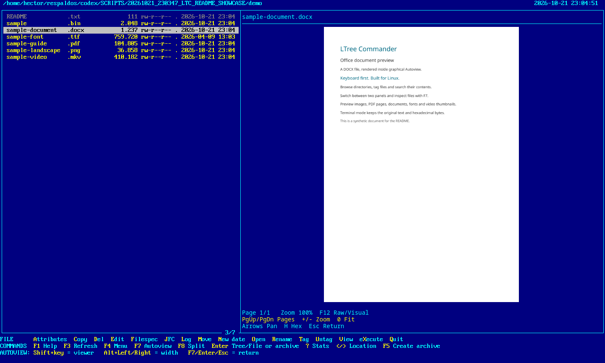

Office documents are converted through a temporary, isolated LibreOffice profile.


### Font specimens and glyph pages

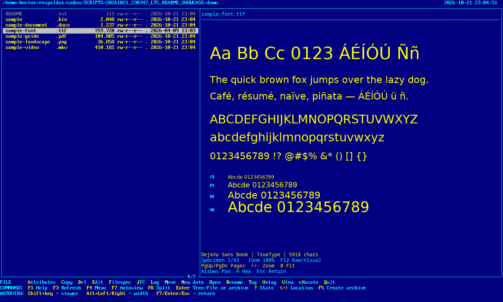

Inspect fonts without installing them. Page through the specimen and Unicode glyph grid.


### Video thumbnail from the shared desktop cache

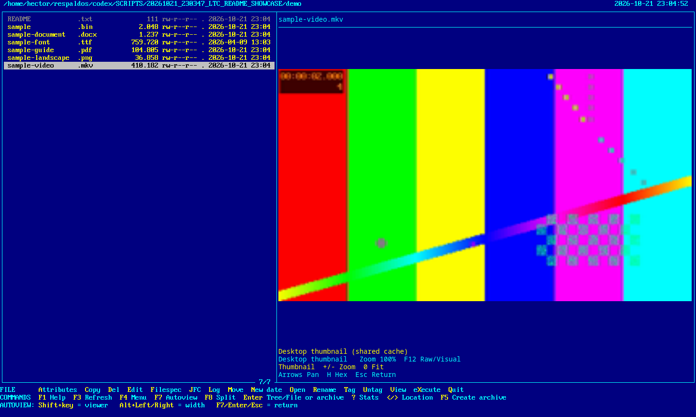

The test-pattern video and its thumbnail are synthetic. The preview identifies its source as the shared desktop cache and keeps the frame fixed.


### Terminal navigation and raw hexadecimal Autoview

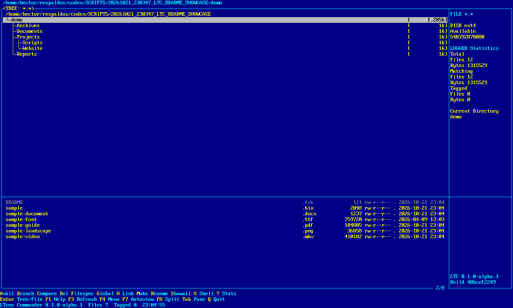

The terminal interface supports local consoles and SSH sessions without a graphical server.

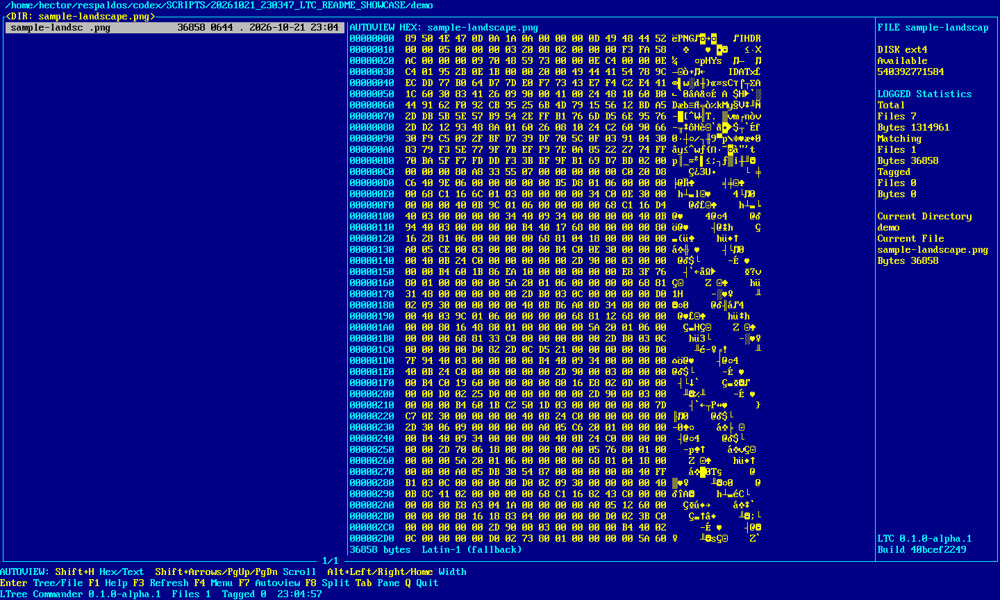

The PNG shown visually above is displayed here as its original bytes. This behavior is the same in Kitty and ordinary terminals.


### Regular expression search, ZIP browsing and hexadecimal editing

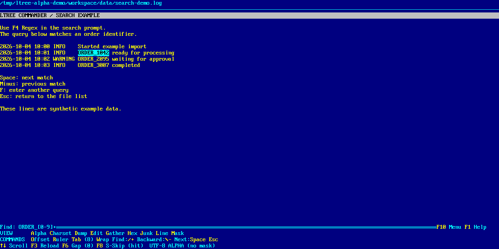

Search results carry into the viewer; Space continues through matches.

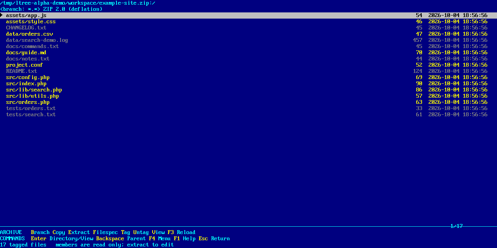

Browse and extract archive members with the familiar file-list workflow.

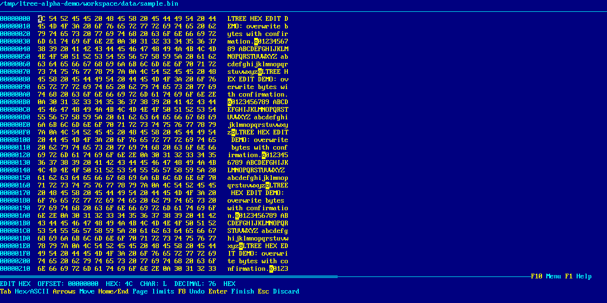

The internal editor replaces existing bytes and confirms writes.


### Contextual F1 manual

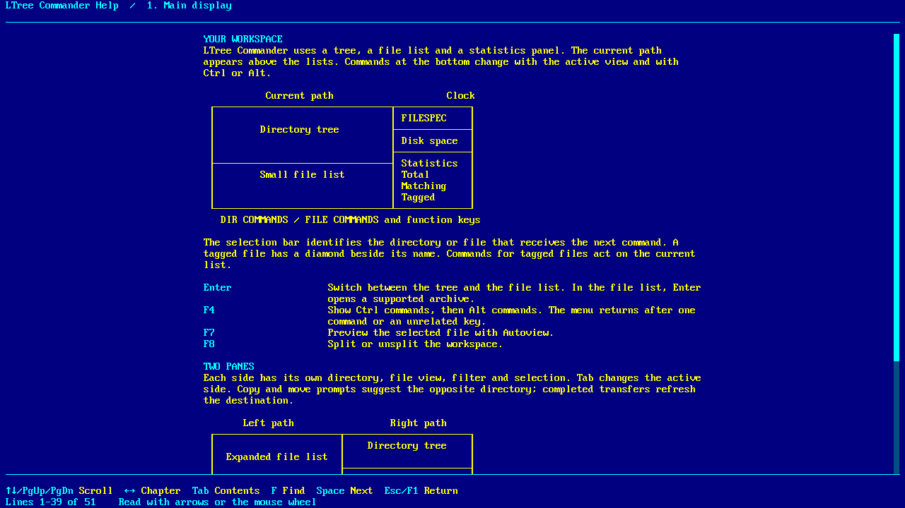

The manual covers the display, keys and command workflows inside the application.


## Current limitations

- **Alpha compatibility:** full ZTree command/configuration/macro compatibility is unfinished. Consult [alpha status](docs/ALPHA.md) for the detailed scope.
- **Viewer limits:** text/raw viewers buffer at most **32 MiB**. Regex matching is evaluated by line; multiline expressions are not implemented.
- **Archive editing:** extract members before editing them. In-place updates and encrypted archive creation are not implemented; RAR variants need broader testing.
- **Metadata:** recursive permission editing, ACL/owner management and some filesystem-specific operations remain incomplete.
- **Recovery:** ordinary Delete is permanent; Prune offers an optional trash mode. There is no global undo or recovery journal. Canceling a batch preserves completed operations; interrupted moves between filesystems can require manual cleanup.
- **Desktop behavior:** graphical size and window state are remembered. X11 placement can be restored; Wayland leaves window placement to the compositor. Terminal window geometry belongs to the emulator.

Try destructive commands with disposable files while evaluating the alpha. Report problems with the release/build identifier, interface, distribution and steps that reproduce them.

## Documentation

| Guide | Contents |
| --- | --- |
| [Build and installation](docs/BUILD.md) | Dependencies, Qt-free compilation, other distributions, fonts, tests and desktop setup |
| [Terminal mode](docs/TERMINAL.md) | Commands, editors, modifier-key limitations and terminal integration |
| [Detailed usage](docs/USAGE.md) | Spanish command walkthroughs |
| [Viewer and archives](docs/VISOR_Y_COMPRIMIDOS.md) | Spanish viewer/archive workflows and protections |
| [Alpha status](docs/ALPHA.md) | Capabilities, validation and remaining work |
| [Implementation notes](docs/IMPLEMENTACION.md) | Spanish design notes and implementation limits |
| [Changelog](CHANGELOG.md) | Recorded changes |
| [Third-party notices](THIRD_PARTY.md) | Dependencies, font provenance and licenses |

## Credits and license

### Origins and compatibility goal

LTree Commander is an independent implementation inspired by **ZTreeWin / ZTreeBold by ZEDTEK, Inc.** The earlier lineage is **XTree / XTreeGold for DOS**. ZTree describes its history on its [official website](https://www.ztree.com/) and in its [FAQ](https://www.ztree.com/html/faq.htm).

The goal is to reproduce that workflow as faithfully as possible on Linux, while adding Linux integration and optional graphical previews. This project is not affiliated with or endorsed by ZEDTEK or the owners of XTree. Original ZTree/XTree code, binaries, manuals and logos are not included. Product names belong to their respective owners.

### Development and contributions

LTree Commander is developed through collaboration between **[Hector De Armas (dejotaerre)](https://github.com/dejotaerre)** and **[OpenAI Codex](https://developers.openai.com/codex/)**, an AI coding assistant.

- **Hector De Armas:** project direction, ZTree workflow knowledge, requirements, usability feedback and hands-on testing.
- **OpenAI Codex (AI contribution):** substantial assistance with implementation, debugging, automated tests, documentation and Linux packaging. This is attribution of AI assistance.

Contributions and reproducible bug reports are welcome through [GitHub issues](https://github.com/dejotaerre/ltree-commander/issues).

### License

Copyright © 2026 **Hector De Armas (dejotaerre)**. LTree Commander's original code, documentation and project-created assets are available under the **[GNU General Public License, version 3 or later](LICENSE)** (`GPL-3.0-or-later`), without warranty. See [LICENSE](LICENSE) for the terms.

Dependencies retain their own licenses. QTermWidget is GPL-2.0-or-later; distributing a combined executable also requires complying with its applicable GPL terms and the licenses of the other included libraries/fonts. See [THIRD_PARTY.md](THIRD_PARTY.md). Revisions previously published under MIT retain their original licensing terms.
